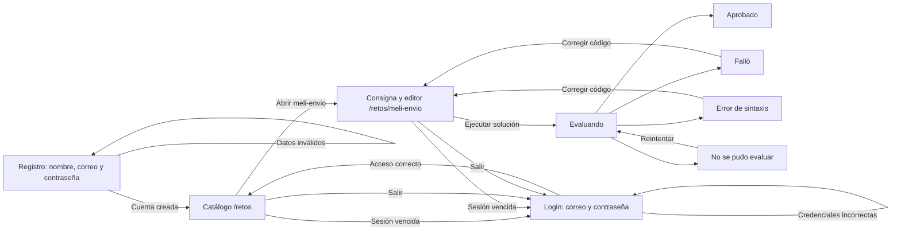
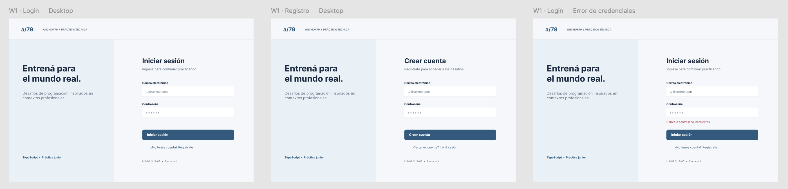
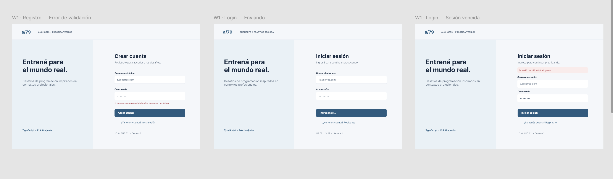
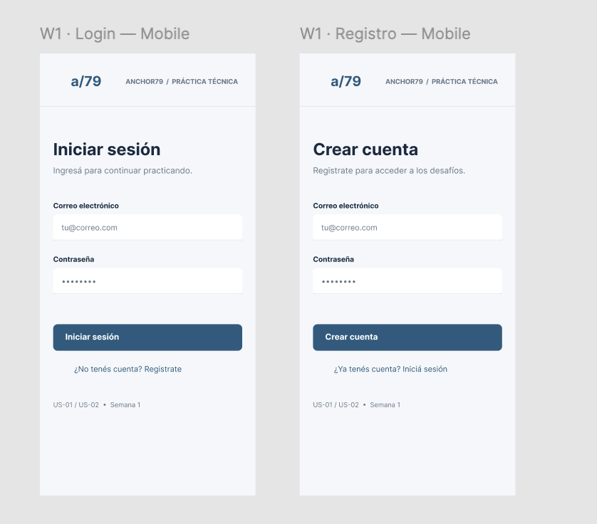

# Anchor79 — frontend P0

Implementa registro, inicio/cierre de sesión, catálogo y resolución del primer reto con React, TypeScript y Monaco. El backend actual también publica los retos de Globant y Workana, por lo que el catálogo los muestra sin añadir flujos distintos.

## Ejecutar

Requiere Node.js `^20.19.0` o `>=22.12.0` y npm. Desde `frontend/`:

```bash
npm ci
npm run dev
```

Abrir `http://localhost:5173`. La app usa por defecto la API publicada en Render (`https://proyecto79-1.onrender.com/api`), así que no requiere configurar variables para esta demo. Para apuntar al backend local, crear `frontend/.env.local` con `VITE_API_URL=http://localhost:3000/api` (o el puerto real de `backend/index.ts`). `.env.example` documenta el valor de producción. Render puede tardar en responder tras un período de inactividad.

```bash
npm run build
npm audit --audit-level=moderate
```

## Wireflows del recorrido entregado

El recorrido implementado va de registro o login al catálogo y luego al primer reto. El usuario escribe código, lo envía al backend y recibe uno de cuatro resultados. Los errores de acceso permiten corregir los datos; una sesión vencida vuelve al login. Un fallo de evaluación permite corregir o reintentar sin perder el borrador.



Las siguientes son las **capturas de wireframes aportadas por Miguel**. Haz clic en cada imagen para verla a tamaño completo. Los bocetos muestran el modo claro; la aplicación también usa modo oscuro según el sistema.

### 1. Acceso en escritorio

Login, registro y error de credenciales. Corresponde a `/login` y `/registro`.

[](../docs/wireflows/01-acceso-desktop.png)

### 2. Estados de acceso

Error de validación en registro, envío del formulario y aviso de sesión vencida. En el código, la sesión vencida también se activa ante una respuesta 401 de la API.

[](../docs/wireflows/02-estados-acceso-desktop.png)

### 3. Acceso móvil

Los formularios se apilan en pantalla estrecha y mantienen las mismas acciones que en escritorio.

[](../docs/wireflows/03-acceso-mobile.png)

### 4. Catálogo y primer reto

El catálogo lleva a la consigna, al editor y al resultado de evaluación. Corresponde a `/retos` y `/retos/meli-envio`.

[](../docs/wireflows/04-catalogo-reto.png)

**Diferencias entre boceto y código:** el registro implementado incluye `nombre`, acordado después de dibujar el wireframe. La cuarta captura usa “Operaciones de pedidos” como ejemplo visual; el primer reto real que entrega el backend es “Umbral de Envío Gratis” (`meli-envio`). La consigna, el ejemplo y el código inicial se cargan desde la API.

## Flujo y organización

- `src/features/auth`: formularios de registro/login, sesión JWT, expiración y cierre de sesión.
- `src/features/catalog`: catálogo autenticado de retos reales de la API.
- `src/features/workspace`: consigna, Monaco TypeScript, ejecución y cuatro estados de evaluación.
- `src/components`: encabezado compartido.
- `src/services`: cliente HTTP y mensajes de error.
- `src/types`: contrato de datos con el backend.

El código del reto se guarda en `sessionStorage` por usuario y reto. Sigue disponible tras un error o reintento y desaparece al cerrar la sesión del navegador. El JWT se guarda en `localStorage` hasta que el usuario salga o expire a las 24 horas definidas por el backend. Una respuesta 401 fuerza el regreso a login con aviso de sesión vencida.

## Contrato utilizado

| Acción | Endpoint | Datos |
| --- | --- | --- |
| Registro | `POST /api/auth/register` | `nombre`, `email`, `password` |
| Login | `POST /api/auth/login` | `email`, `password` |
| Catálogo | `GET /api/retos` | JWT |
| Detalle | `GET /api/retos/detalle/:id` | JWT |
| Evaluar | `POST /api/retos/ejecutar` | JWT, `challengeId`, `language: "typescript"`, `code` |

El primer reto semilla es `meli-envio`, “Umbral de Envío Gratis”. El backend recibe un programa TypeScript completo que lee stdin y escribe stdout; el código inicial de la API ya incluye esa lectura. La evaluación puede devolver `APPROVED`, `FAILED`, `SYNTAX_ERROR` o `EVALUATION_UNAVAILABLE`. Los casos ocultos y sus salidas no se exponen en el frontend.

## Decisiones y límite de esta entrega

La sección R3 del PRD antiguo dice JavaScript, pero los retos semilla, la documentación del repositorio y el ejecutor actual usan TypeScript. Este frontend sigue el contrato implementado de TypeScript. El modo claro usa el diseño adjunto; el oscuro sigue `prefers-color-scheme`. Todos los colores visibles se derivan de la paleta acordada.

No incluye SSO, perfiles, historial de ejecuciones, ranking, otros flujos de producto ni despliegue de Vercel. Para confirmar el flujo completo en producción hará falta una cuenta de prueba y que Judge0 esté operativo en el backend.
