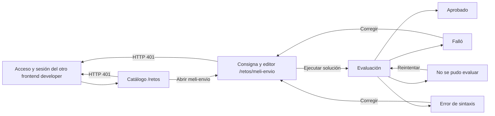
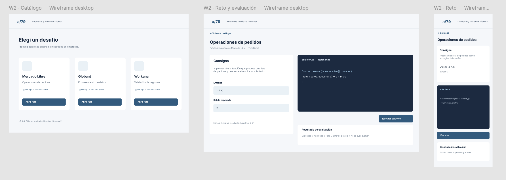

# Anchor79 — catálogo y primer reto

Esta rama aporta el recorrido **posterior al acceso**: catálogo de retos, apertura de `meli-envio`, edición de una solución TypeScript y resultado de evaluación. El registro, el login, la sesión JWT, el encabezado y las rutas protegidas pertenecen al otro frontend developer. Estos módulos reciben la sesión como propiedades y no implementan formularios de acceso.

## Wireflow implementado



La captura de Figma muestra el catálogo, la consigna, el editor y la respuesta de evaluación. Utiliza “Operaciones de pedidos” como ejemplo visual; el primer reto real del backend es **“Umbral de Envío Gratis”** (`meli-envio`). El texto y el código inicial llegan desde la API.

[](../docs/wireflows/04-catalogo-reto.png)

## Archivos de esta contribución

| Ruta | Responsabilidad |
| --- | --- |
| `src/features/catalog/CatalogPage.tsx` | Carga el catálogo y enlaza con cada reto. |
| `src/features/workspace/ChallengePage.tsx` | Muestra consigna, editor, ejecución y cuatro estados de evaluación. |
| `src/features/workspace/monaco.ts` | Carga Monaco y los workers locales de TypeScript. |
| `src/features/practice.css` | Estilos limitados al contenedor `.a79-practice`, con la paleta acordada y modo oscuro según el sistema. |
| `src/services/api.ts` | Cliente HTTP de los tres endpoints de retos. |
| `src/types/api.ts` | Contratos de retos, evaluación y propiedades de integración. |

## Instalar y verificar esta rama

Con Node.js `^20.19.0` o `>=22.12.0`, desde `frontend/`:

```bash
npm ci
npm run typecheck
```

`package.json`, `package-lock.json` y `tsconfig.json` están versionados. Esta rama instala y verifica sus módulos, pero no contiene todavía el punto de entrada ni el comando de build de la aplicación completa. Para hacer el despliegue se deben ensamblar las rutas con el trabajo de acceso del otro frontend developer.

## Integración con el frontend de acceso

Las dependencias React, React Router, TypeScript, `@monaco-editor/react` y `monaco-editor` están declaradas en `package.json`. `monaco.ts` usa el manejo de workers de Vite (`?worker`). El proyecto anfitrión define `VITE_API_URL` si la API no está en `https://proyecto79-1.onrender.com/api`.

En las rutas protegidas del frontend anfitrión, montar:

```tsx
<Route path="/retos" element={
  <CatalogPage token={session.token} onUnauthorized={handleUnauthorized} />
} />
<Route path="/retos/:id" element={
  <ChallengePage
    token={session.token}
    userId={session.user.id}
    onUnauthorized={handleUnauthorized}
  />
} />
```

El anfitrión debe renderizar estas rutas solo con una sesión válida. `handleUnauthorized` limpia la sesión y redirige al acceso que implemente el compañero. El encabezado global también lo renderiza el anfitrión. Los enlaces internos de esta entrega usan `/retos` y `/retos/:id`; no contienen rutas de registro ni login.

## API y comportamiento

| Acción | Endpoint | Datos |
| --- | --- | --- |
| Catálogo | `GET /api/retos` | JWT |
| Detalle | `GET /api/retos/detalle/:id` | JWT |
| Evaluar | `POST /api/retos/ejecutar` | JWT, `challengeId`, `language: "typescript"`, `code` |

El código del reto se conserva en `sessionStorage` por `userId` e identificador de reto. Los casos de prueba ocultos quedan en el backend. El frontend muestra `APPROVED`, `FAILED`, `SYNTAX_ERROR` y `EVALUATION_UNAVAILABLE`; una falla técnica permite reintentar sin borrar el código. Una respuesta HTTP 401 invoca `onUnauthorized` para que el módulo de acceso gestione la sesión vencida.

Esta rama entrega módulos para integrar en la aplicación del equipo. El arranque de Vite y el despliegue se configuran en la rama que ensamble el frontend completo.
